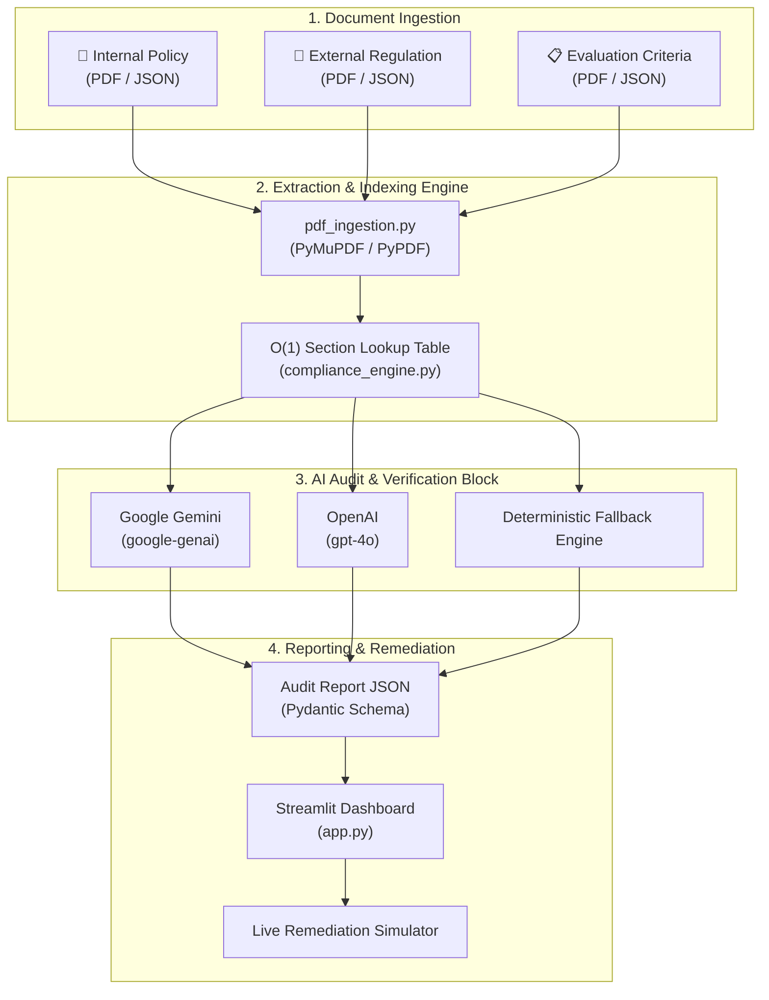

# 🛡️ Compliance & Audit Alignment Engine

[](https://www.python.org/)
[](https://docs.pydantic.dev/)
[](https://streamlit.io/)
[](https://ai.google.dev/)
[](https://openai.com/)
[](LICENSE)

An enterprise-grade, AI-powered compliance engine that automates comparative audit verification between **Internal Policy Documents** and **External Regulatory Mandates** (e.g., MiFID II, SEC, FINRA) against strict **Evaluation Criteria Statements**.

The system ingests both **multi-page PDF documents** and **relational JSON datasets**, extracts sections page-by-page, performs rigorous comparative gap analyses using structured LLMs, and generates data-backed **PASS / FAIL** audit reports with verbatim remediation proposals.

---

## 🌟 Key Features

- **📑 Multi-Format Ingestion Engine**:
  - Ingests native **JSON relational schemas** or multi-page **PDF files**.
  - Automatically parses PDF pages into structured, page-indexed JSON sections using PyMuPDF (`pymupdf`) and PyPDF (`pypdf`).
- **🧠 Multi-Model AI Verification**:
  - **Google Gemini**: Native structured outputs via the official `google-genai` SDK (`gemini-2.5-flash`, `gemini-1.5-pro`).
  - **OpenAI**: Native Pydantic schema parsing via `client.beta.chat.completions.parse` (`gpt-4o`, `gpt-4o-mini`).
  - **Deterministic Offline Rule Engine**: Built-in deterministic fallback heuristic for testing and CI/CD pipelines without external API keys.
- **⚡ High-Performance Indexing**:
  - Constructs an $O(1)$ section lookup table indexing sections, page numbers, headings, and raw text.
- **🛡️ Evidence-Backed Audit Flags**:
  - Evaluates alignment strictly as **PASS** (Fully Aligned) or **FAIL** (Misaligned / Gaps Detected).
  - Supplies step-by-step reasoning citing verbatim text conflicts and explicit gap breakdowns.
- **🔄 Verbatim Remediation Proposals**:
  - For any detected compliance gaps (**FAIL**), generates the exact revised text required to turn the policy into a **PASS**.
- **📊 Interactive Streamlit Audit Dashboard**:
  - Executive KPI tiles, alignment score metrics, and status filtering.
  - Side-by-side comparative document comparator (Internal Policy vs External Regulation).
  - **Interactive Remediation Simulator**: Test proposed policy edits in real time and watch the audit status flip from **FAIL** to **PASS**.
  - Document repository inspector and one-click JSON audit report download.

---

## 🏛️ System Architecture



---

## 📦 Project Structure

```text
├── app.py                           # Enterprise Streamlit demonstration dashboard
├── compliance_engine.py             # Core pipeline: Ingestion, LLM evaluation, and reporting
├── pdf_ingestion.py                 # PDF page-by-page extraction and JSON converter
├── requirements.txt                 # Project dependencies
├── .env.example                     # Environment variables template
├── .gitignore                       # Git exclusion rules for secrets and virtualenvs
│
├── sample_internal_policy.json      # Sample Internal Policy (Operations Codebook)
├── sample_internal_policy.pdf       # Sample Internal Policy PDF
│
├── sample_external_regulation.json  # Sample External Regulation (MiFID II Article 24)
├── sample_external_regulation.pdf   # Sample External Regulation PDF
│
├── sample_evaluation_criteria.json  # Sample Evaluation Criteria (Best Execution Mandate)
├── sample_evaluation_criteria.pdf   # Sample Evaluation Criteria PDF
│
├── audit_report.json                # Serialized JSON audit report from pipeline run
└── audit_report_from_pdf.json       # Audit report generated directly from PDF inputs
```

---

## 🚀 Quick Start Guide

### 1. Prerequisites
- Python 3.12+ (Python 3.13 fully supported)
- macOS, Linux, or Windows

### 2. Clone the Repository
```bash
git clone https://github.com/shashankbr07/Complaince-Engine.git
cd Complaince-Engine
```

### 3. Set Up Virtual Environment
```bash
# Create virtual environment
python3 -m venv "complaince agent"

# Activate environment (note quotation marks for spaces)
source "complaince agent/bin/activate"

# On Windows:
# "complaince agent\Scripts\activate"
```

### 4. Install Dependencies
```bash
pip install -r requirements.txt
```

### 5. Configure API Keys (Optional)
Copy the template environment file:
```bash
cp .env.example .env
```
Edit `.env` and configure your preferred provider:
```ini
# Google Gemini API Key (Recommended)
# Get a key from Google AI Studio: https://aistudio.google.com/app/apikey
GEMINI_API_KEY=your_google_gemini_api_key_here
# or GOOGLE_API_KEY=your_google_api_key_here

# OpenAI API Key (Optional)
OPENAI_API_KEY=your_openai_api_key_here
```
> **Note**: If no API keys are provided, the engine automatically runs in **Deterministic Offline Mode**, allowing full offline demonstration and testing.

---

## 🖥️ Running the Application

### Option A: Launch Interactive Streamlit Dashboard
```bash
source "complaince agent/bin/activate"
streamlit run app.py
```
Open **[http://localhost:8501](http://localhost:8501)** in your browser.

#### Features inside the dashboard:
1. **Executive Dashboard**: Review compliance score, total evaluated rules, passed rules, and gaps detected.
2. **Comparator**: Side-by-side view of the internal policy section versus external regulation with evidence highlighting.
3. **Remediation Simulator**: Amend non-compliant text and click **"Simulate & Re-evaluate Compliance"** to see the status convert from **FAIL** to **PASS** in real time!
4. **Document Repositories**: Inspect raw PDF extractions and relational JSON structures.
5. **JSON Export**: Download finalized compliance reports with one click.

---

### Option B: Headless CLI Pipeline
Run the compliance audit pipeline directly from terminal:
```bash
source "complaince agent/bin/activate"
python compliance_engine.py
```
This executes the ingestion of input documents, runs the comparative audit, prints summary metrics to stdout, and exports `audit_report.json`.

---

## 📋 Case Study: MiFID II Best Execution Audit

The repository comes pre-packaged with an investor protection audit scenario:

### 1. Target Evaluation Criteria (`CRIT_COMP_BEST_EXEC_01`)
> *"The internal policy must explicitly enforce that client orders are routed to venues offering the best net price, lowest transaction costs, and fastest execution speed. It is strictly prohibited to prioritize internal routing networks or affiliate brokers if doing so conflicts with obtaining the absolute best economic outcome for the client."*

### 2. External Regulatory Mandate (`MIFID_SEC_24_3`)
> *"Investment firms must take all sufficient steps to obtain, when executing orders, the best possible result for their clients taking into account price, costs, speed, likelihood of execution and settlement... Firms shall not structure routing configurations to favor internal execution venues over external markets if it results in higher systemic costs to the client."*

### 3. Internal Policy Section (`INT_SEC_4_1`)
> *"Our execution desk prioritizes routing client equity orders exclusively through our internal affiliate broker network. This strategy maximizes internal routing efficiency and maintains centralized volume metrics, regardless of real-time exchange fee variances or external venue latency fluctuations."*

### 4. Engine Audit Result: **FAIL ⚠️**
- **Violation**: The internal policy directs orders exclusively to internal affiliates while openly disregarding cost variances ("regardless of exchange fee variances") and execution latency ("external venue latency fluctuations").
- **Generated Remediation**:
  > *"Replace INT_SEC_4_1 with: 'Our execution desk must take all sufficient steps to obtain the best possible execution result for client orders by evaluating total consideration, including net price, transaction costs, execution speed, and likelihood of settlement across all available venues. Orders shall be dynamically routed to the venue offering the best overall economic outcome for the client. The firm strictly prohibits prioritizing internal affiliate broker networks where doing so results in higher fees, increased latency, or any adverse execution outcome for the client.'"*

---

## 📊 Structured JSON Output Schema

Audits strictly adhere to the following Pydantic schema exported to `audit_report.json`:

```json
{
  "total_criteria_evaluated": 1,
  "passed_count": 0,
  "failed_count": 1,
  "evaluations": [
    {
      "evaluation_criteria_id": "CRIT_COMP_BEST_EXEC_01",
      "alignment_check": {
        "internal_section_evaluated": "INT_SEC_4_1",
        "external_section_evaluated": "MIFID_SEC_24_3",
        "status": "FAIL",
        "rationale": "Direct Conflict: Internal policy INT_SEC_4_1 mandates routing client orders 'exclusively through our internal affiliate broker network' regardless of exchange fee variances or venue latency. This directly breaches External Regulation MIFID_SEC_24_3..."
      },
      "detailed_gap_analysis": {
        "regulatory_requirement": "External section MIFID_SEC_24_3 mandates that investment firms take all sufficient steps to achieve best execution...",
        "internal_policy_behavior": "Internal section INT_SEC_4_1 establishes a strict routing priority favoring internal affiliate brokers..."
      },
      "suggested_remediation": "Replace the raw text of INT_SEC_4_1 with: 'Our execution desk must take all sufficient steps to obtain the best possible execution result...'"
    }
  ]
}
```

---

## 🛠️ Tech Stack

- **Language**: Python 3.12+
- **Data Validation & Schemas**: [Pydantic v2](https://docs.pydantic.dev/)
- **Web UI & Dashboard**: [Streamlit](https://streamlit.io/)
- **PDF Extraction**: [PyMuPDF](https://pymupdf.readthedocs.io/) & [PyPDF](https://pypdf.readthedocs.io/)
- **PDF Generation**: [ReportLab](https://www.reportlab.com/)
- **LLM Integrations**: [Google GenAI SDK](https://github.com/googleapis/python-genai) & [OpenAI Python SDK](https://github.com/openai/openai-python)
- **Environment Management**: [python-dotenv](https://github.com/theskumar/python-dotenv)

---

## 📄 License
This project is licensed under the MIT License - see the [LICENSE](LICENSE) file for details.
